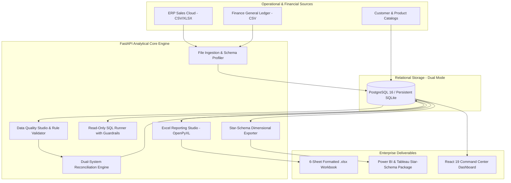

# DATAOPS COMMAND CENTER
### *The Intelligence Layer for Trusted Business Data*

[](https://python.org)
[](https://fastapi.tiangolo.com)
[](https://react.dev)
[](https://typescriptlang.org)
[](https://tailwindcss.com)
[](https://openpyxl.readthedocs.io)
[](https://postgresql.org)
[](https://pytest.org)

---

## 🎯 Executive Overview & Portfolio Positioning

**DataOps Command Center** is a production-grade enterprise data quality, cross-system reconciliation, and business intelligence platform. It acts as an automated intelligence and governance layer between operational sources (such as ERP and POS systems) and financial ledgers (General Ledger / Bank Accounts).

This platform was built to demonstrate staff-level technical competency for a **2027 Computer Science Fresher** applying for high-impact **Data Specialist** positions requiring:
- **Advanced Excel**: Multi-tab workbook generation via `openpyxl` with freeze panes, conditional formatting, auto-fit columns, and financial styles.
- **Advanced SQL**: Common Table Expressions (CTEs), window functions for cumulative running totals, cohort aggregations, and strict read-only execution guardrails.
- **Power BI & Tableau Readiness**: True dimensional star-schema modeling (3NF / Star-Schema), copyable DAX measures, Power Query (M) scripts, and Tableau calculated fields.
- **Python & Data Engineering**: Automated profiling, schema inference, data cleaning, dual-system reconciliation with configurable penny tolerances, and idempotent reruns.
- **Executive Communication**: Strategic insights quantifying financial exposure from bad data and prescriptive recommendations for business stakeholders.

---

## 🌌 Visual Aesthetic: "Luminous Data Universe"

The application departs from generic SaaS themes and admin templates, implementing a custom design language:
- **Background**: Near-black midnight navy (`#080B14`).
- **Surfaces**: Layered dark blue slate (`#101728`, `#131D35`, `#1E293B`).
- **Primary Accent**: Electric luminous cyan (`#42E8F5` / `#00F0FF`).
- **Secondary Accent**: Ultraviolet (`#9B7CFF`).
- **Semantic Accents**: Restrained mint green (`#10B981`), warm amber (`#F59E0B`), coral red (`#F43F5E`).
- **Signature Visual Experience**: Custom animated **Data Universe** pipeline visualization on the main dashboard representing live pipeline states:
  $$\text{SOURCE} \longrightarrow \text{INGESTION} \longrightarrow \text{VALIDATION} \longrightarrow \text{RECONCILIATION} \longrightarrow \text{REPORTING} \longrightarrow \text{BUSINESS INSIGHTS}$$

---

## 🏗️ System Architecture



---

## 📊 Core Application Modules

| Route | Module Name | Core Capabilities |
|---|---|---|
| `/overview` | **Command Center** | Signature animated Data Universe pipeline, volume/defect charts, dimension breakdown, priority alerts. |
| `/sources` | **Data Sources** | Drag-and-drop CSV/XLSX upload, safe parsing (no macros), null-rate profiling, schema drift warnings. |
| `/quality` | **Data Quality Studio** | 6 active governance rules (Completeness, Uniqueness, Validity, Integrity), slide-out Issue Drawer. |
| `/reconciliation` | **Reconciliation Lab** | Cross-system matching on business keys, configurable tolerance slider ($\pm \$0.05$), exception remediation. |
| `/sql` | **SQL Intelligence** | CTE templates, window running totals, department error rates, safe read-only SQL executor with CSV export. |
| `/reports` | **Excel Reporting** | OpenPyXL generator creating 6-sheet corporate workbooks with freeze panes, conditional formatting, and formulas. |
| `/bi-workspace` | **Power BI / Tableau** | Star-schema model, tested copy-paste DAX measures, Power Query M code, Tableau formulas, zip package download. |
| `/operations` | **Audit & Operations** | SHA-256 batch checksums, processing run latencies, directed data lineage graph, and immutable audit logs. |
| `/insights` | **Business Insights** | Quantified financial exposure, department error concentrations, trend velocities, and action recommendations. |
| `/settings` | **Settings & Docs** | Canonical data dictionary, mathematical KPI formulas, project architecture, and interview talking points. |

---

## 📐 Dimensional Data Model (Star-Schema)

```mermaid
erDiagram
    FactTransactions }o--|| DimCustomer : "customer_id"
    FactTransactions }o--|| DimProduct : "product_sku"
    FactTransactions }o--|| DimDepartment : "department"
    FactTransactions }o--|| DimDate : "date_key"
    FactDataQualityIssues }o--|| FactTransactions : "record_identifier"

    FactTransactions {
        int transaction_key PK
        string transaction_id AK
        datetime transaction_date
        string customer_id FK
        string product_sku FK
        string department FK
        int quantity
        float unit_price
        float total_amount
        boolean is_valid
    }

    DimCustomer {
        int customer_key PK
        string customer_id AK
        string customer_name
        string segment
        string region
        string country
    }

    DimProduct {
        int product_key PK
        string product_sku AK
        string product_name
        string category
        float list_price
    }

    DimDepartment {
        int department_key PK
        string department_code AK
        string department_name
        string cost_center
    }

    DimDate {
        int date_key PK
        string full_date
        int year
        string quarter
        string month_name
    }
```

---

## 📈 Canonical Metric Definitions

Every number displayed in the platform is derived deterministically from underlying transactions:

1. **Total Monitored Revenue**:
   $$\text{Total Revenue} = \sum (\text{total\_amount})$$
2. **Data Quality Pass Rate**:
   $$\text{Pass Rate} = \left( \frac{\sum (\text{is\_valid} = \text{TRUE})}{\text{Total Records}} \right) \times 100$$
3. **Weighted Quality Health Score** (DAMA-DMBOK):
   $$\text{Score} = (0.30 \times \text{Completeness}) + (0.25 \times \text{Uniqueness}) + (0.25 \times \text{Validity}) + (0.20 \times \text{Integrity})$$
4. **Reconciliation Match Rate**:
   $$\text{Reconciliation Rate} = \left( \frac{\text{Matched Count} + \text{Tolerance Matched Count}}{\text{Total Source A Records}} \right) \times 100$$
5. **Net Ledger Variance**:
   $$\text{Net Variance} = \sum (\text{Source A Amount}) - \sum (\text{Source B Amount})$$

---

## 🧪 Controlled Synthetic Defect Manifest

The generator produces reproducible ERP operational batches and General Ledger pairings across 3 consecutive months with controlled anomalies:

- **Missing Customer IDs** (`REQ_CUST_ID`): Null customer references violating referential completeness.
- **Duplicate Transaction IDs** (`UNQ_TXN_ID`): Re-transmitted transaction payloads creating double-booking risk.
- **Negative / Out-of-Range Amounts** (`NUM_AMOUNT_POS`): Negative revenues without corresponding credit memos.
- **Calculation Discrepancies** (`CROSS_TOTAL_MATCH`): Invoice total does not equal $\text{Quantity} \times \text{Unit Price}$.
- **Standardization Drift** (`CAT_VALID_DEPT`): Product categories with inconsistent casing violating reporting hierarchies.
- **Timing Differences** (`TIMING_DIFFERENCE`): Legitimate end-of-month cut-off postings existing in ERP but pending GL journal entry.
- **Penny Tolerance Rounding** (`MATCHED_WITH_TOLERANCE`): Ledger variance within $\pm \$0.05$ tolerance margin.
- **Major Ledger Mismatches** (`AMOUNT_MISMATCH`): Significant discrepancies ($>\$0.05$) flagged for investigation.
- **Orphan Ledger Adjustments** (`MISSING_IN_A`): Manual journal vouchers in GL with no corresponding source operational record.

---

## 📑 Excel Reporting Studio (OpenPyXL Specification)

The reporting engine generates downloadable `.xlsx` workbooks containing 6 structured worksheets:

1. **Executive Summary**: Banner branding, KPI metric summary blocks, and dual-system reconciliation summary.
2. **Data Quality Report**: Evaluated vs failed record counts, pass rates, and conditional alert fills (mint/amber/coral).
3. **Reconciliation Summary**: Comparative analysis between ERP and GL, tolerance matches, and net variance.
4. **Exception Register**: Itemized line-by-line exceptions with transaction IDs, variance amounts, assigned owners, and status.
5. **Cleaned Data**: Curated transactional records with currency number formatting (`$#,##0.00`) and validated status flags.
6. **Processing Audit**: Immutable run logs, batch identifiers, execution durations, and timestamps.

*All sheets feature Segoe UI typography, frozen header rows (`freeze_panes = 'A2'`), and auto-fitted column widths.*

---

## ⚡ Power BI & Tableau Readiness

### Power BI DAX Measures (Tested)
```dax
// Total Monitored Revenue
Total Revenue = SUM(FactTransactions[total_amount])

// Data Quality Pass Rate
DQ Pass Rate = 
DIVIDE(
    CALCULATE(COUNTROWS(FactTransactions), FactTransactions[is_valid] = TRUE()),
    COUNTROWS(FactTransactions),
    1.0
)

// Reconciliation Match Rate
Reconciliation Rate = 
DIVIDE(
    SUM(FactReconciliationRuns[matched_amount]),
    SUM(FactReconciliationRuns[source_a_amount]),
    1.0
)

// Net Ledger Variance
Net Variance = SUM(FactReconciliationRuns[net_variance])
```

### Tableau Calculated Fields
```tableau
// DQ Pass Percentage
SUM(IF [Is Valid] = TRUE THEN 1 ELSE 0 END) / COUNT([Transaction Id])

// Variance Severity Flag
IF ABS([Source A Amount] - [Source B Amount]) > 0.05 THEN 'High Variance' ELSE 'Within Tolerance' END
```

---

## 🚀 Quick Start & Local Setup

### Option 1: Native Local Development (Windows / macOS / Linux)

#### 1. Backend Setup
```bash
cd backend

# Install dependencies (Python 3.12+)
pip install -r requirements.txt

# Run automated test suite (100% passing)
pytest tests -v

# Start FastAPI backend server
python run.py
# -> Runs on http://127.0.0.1:8000
```

#### 2. Frontend Setup
```bash
cd frontend

# Install Node dependencies
npm install

# Build production bundle
npm run build

# Start development server
npm run dev
# -> Runs on http://127.0.0.1:5173
```

#### 3. Seed Demonstration Data
- Click **"Load Demo Batches"** in the top-right of the dashboard, or run:
```bash
python scripts/seed_demo.py
```

### Option 2: Docker Compose (Production Setup)
```bash
docker-compose up --build
```
- Frontend: `http://localhost:5173`
- Backend API: `http://localhost:8000`
- PostgreSQL: `localhost:5432`

---

## 🎤 5-Minute Recruiter Demonstration Script

1. **Minute 1: The Problem & Value Proposition**
   - *"In high-volume business operations, operational databases and general ledgers constantly drift out of sync due to timing issues, format errors, and manual adjustments. I built the DataOps Command Center as an automated intelligence layer to detect and resolve these discrepancies before reports reach leadership."*
2. **Minute 2: Real-time Ingestion & Data Quality Studio**
   - Navigate to `/sources` and `/quality`.
   - *"Here we profile uploaded CSV/Excel files and evaluate 6 active governance rules. Every rule preserves the original invalid value and computes a weighted quality score across Completeness, Uniqueness, Validity, and Integrity."*
3. **Minute 3: Dual-System Reconciliation Lab**
   - Navigate to `/reconciliation`.
   - *"This engine compares ERP operations against the Finance General Ledger. We support configurable penny tolerances (e.g. $0.05) to distinguish minor rounding from true revenue leakage, categorizing items into exact matches, tolerance matches, timing differences, and orphan entries."*
4. **Minute 4: Professional Excel Generation & SQL Intelligence**
   - Navigate to `/reports` and `/sql`.
   - *"Because Excel and SQL are central to the Data Specialist role, I implemented an OpenPyXL engine generating 6-sheet workbooks with freeze panes and financial formatting, alongside an interactive SQL terminal supporting CTEs and window running totals."*
5. **Minute 5: Power BI / Tableau Integration & Architecture**
   - Navigate to `/bi-workspace` and `/insights`.
   - *"Finally, data specialists must prepare data for BI tools. The BI Workspace exports clean 3NF star-schema CSVs and provides tested DAX measures and Tableau formulas, while Business Insights quantifies the financial exposure of defective records."*

---

## 🛡️ License & Standards
Developed under modern enterprise data governance guidelines (DAMA-DMBOK, ISO 8000). MIT License.
